<div align="center">

# SafeStorage

**Blazing-fast, self-hosted file uploader & bunker written in Node.js 🚀**

Upload files, get short links, organise them into albums, and keep everything on **your** hardware — or in your own S3 bucket.

<!-- buttons -->

<!-- endbuttons -->

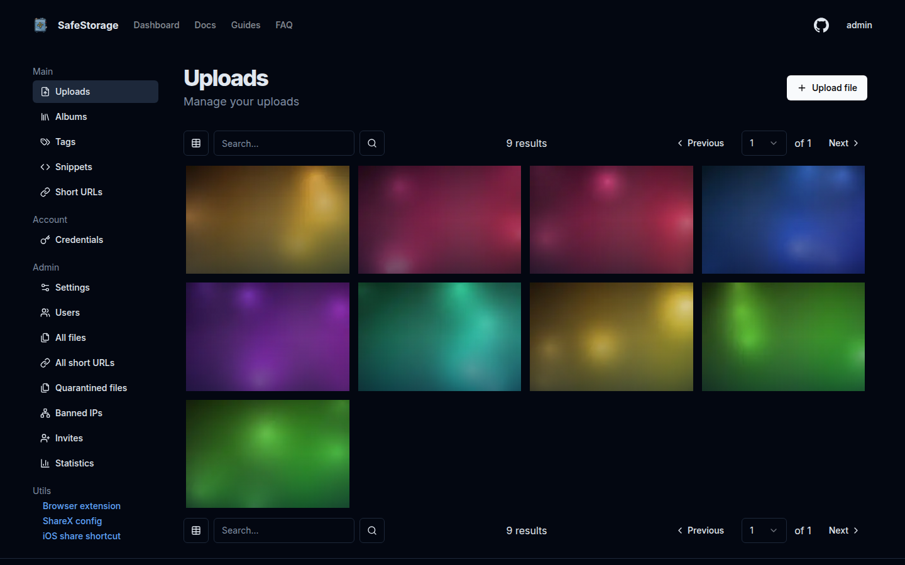

</div>

## What is SafeStorage?

SafeStorage is a self-hosted file hosting service. You drop files in, it gives you links back — and unlike a dozen SaaS uploaders, the data never leaves a machine you control.

It runs as **one container** (nginx + Fastify backend + Next.js frontend) with an SQLite database, so there is nothing else to install and no external services to pay for. Point an S3-compatible bucket at it if you'd rather not store on disk.

## Features

-   📤 **Chunked & huge uploads** — multi-gigabyte files, straight through nginx without buffering.
-   🔗 **Short links** — shareable URLs, plus a built-in URL shortener.
-   🖼️ **Albums & tags** — organise, sort (custom default order) and share public albums.
-   📝 **Snippets** — paste and share code with syntax highlighting.
-   🖱️ **Thumbnails** — automatic image thumbnails and video previews (bundled `ffmpeg`).
-   🌐 **S3-compatible storage** — AWS S3, Backblaze B2, Cloudflare R2, Wasabi, MinIO, …
-   👥 **Users, roles & invites** — owner/admin/user accounts, per-user quotas, public (anonymous) mode.
-   🛡️ **Moderation** — file quarantine, extension blocking, IP banning, invite-only registration.
-   📊 **Admin panel** — statistics, diagnostics, update checks and full branding control.
-   🧩 **REST API + live docs** — a documented JSON API and a Scalar/OpenAPI reference at `/docs`.

## Screenshots

Every image below comes from a real SafeStorage instance, seeded with synthetic demo data and captured by a headless browser. See [`docs/screenshots`](docs/screenshots) to regenerate them.

|                                                                                               |                                                                                             |
| --------------------------------------------------------------------------------------------- | ------------------------------------------------------------------------------------------- |
| **Landing page**<br>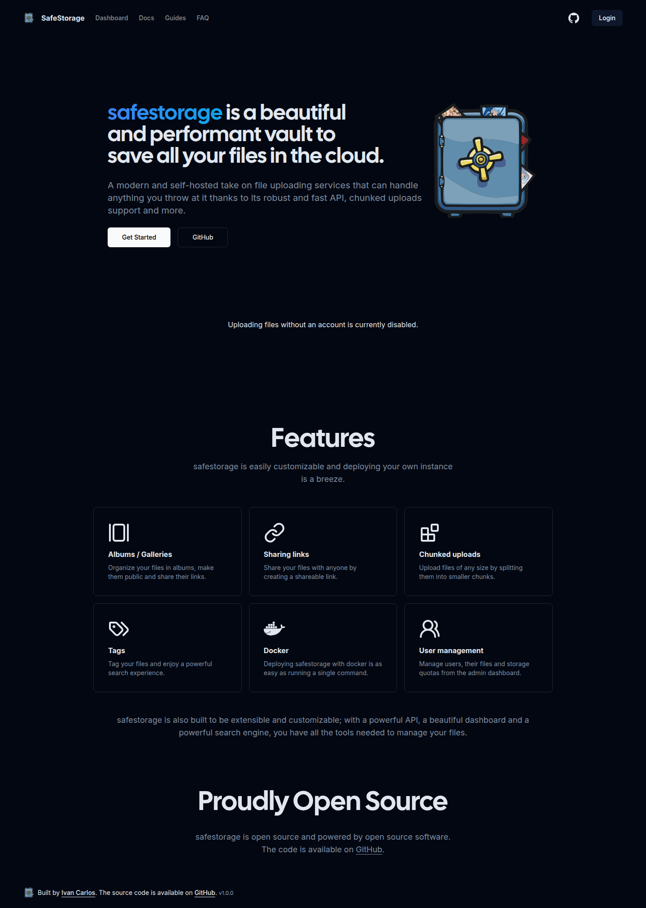                     | **Login**<br>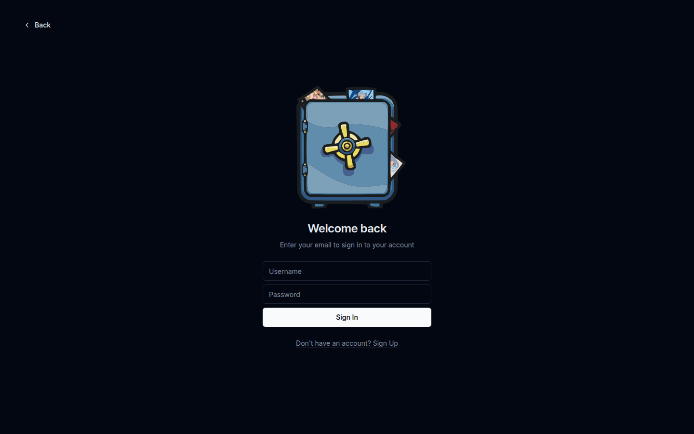                                  |
| **Albums**<br>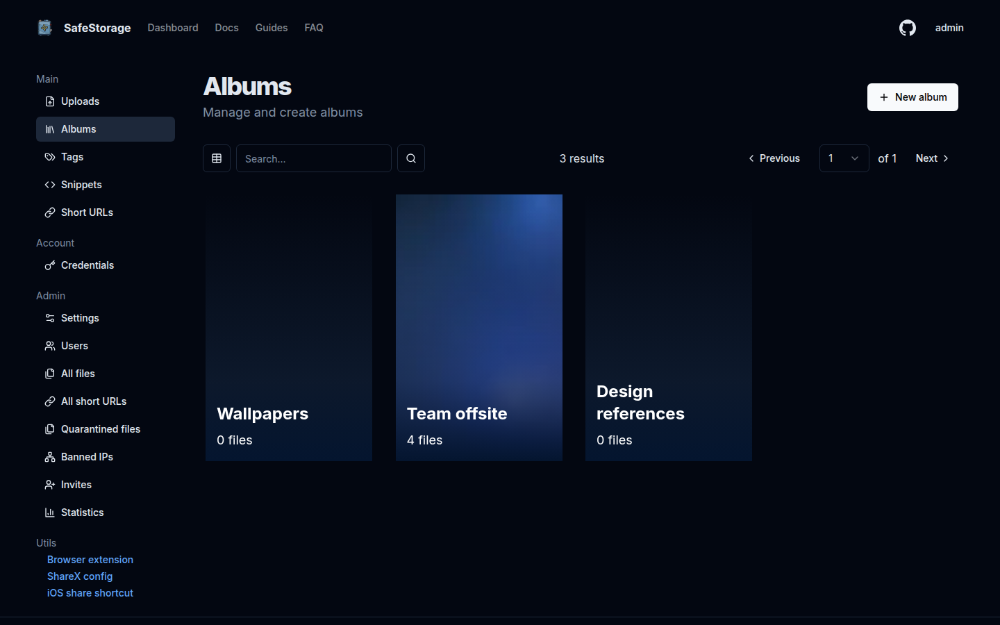                                  | **Album**<br>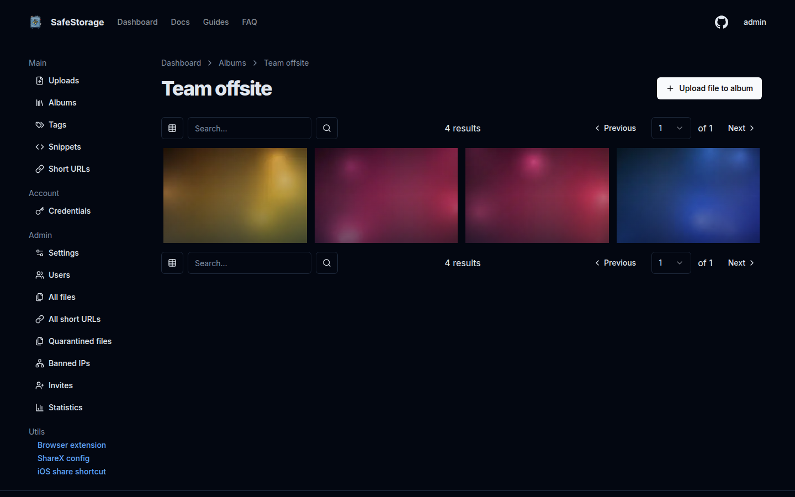                   |
| **Public album**<br>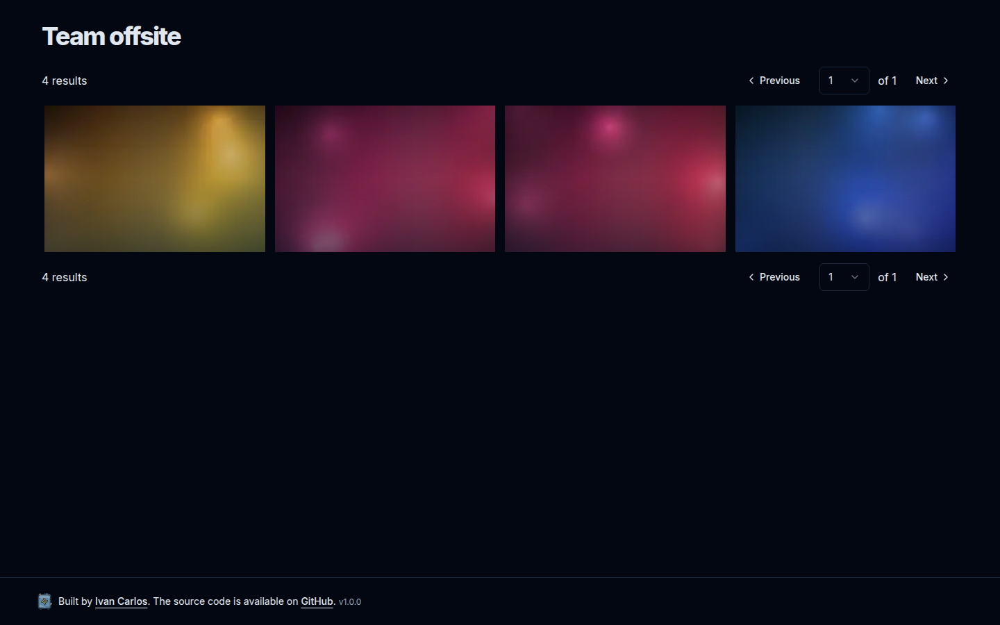                 | **Tags**<br>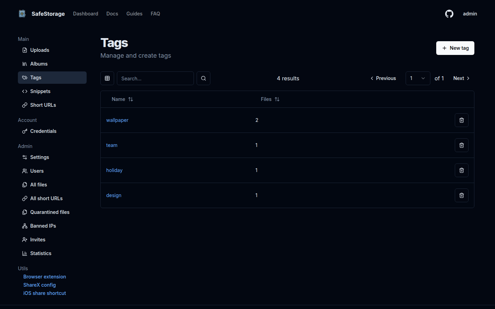                                      |
| **Snippets**<br>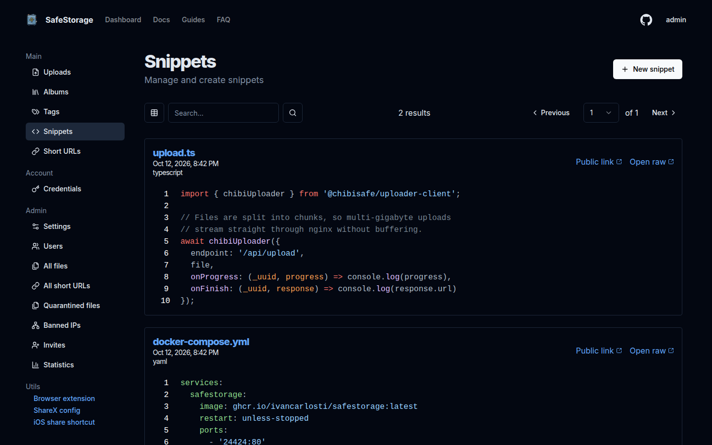                            | **Snippet**<br>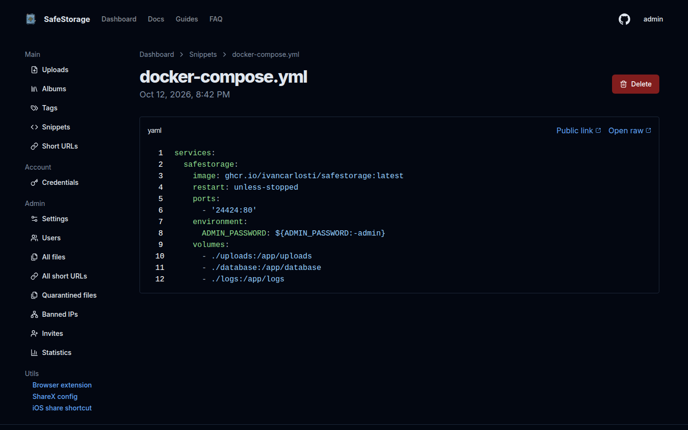                       |
| **Short URLs**<br>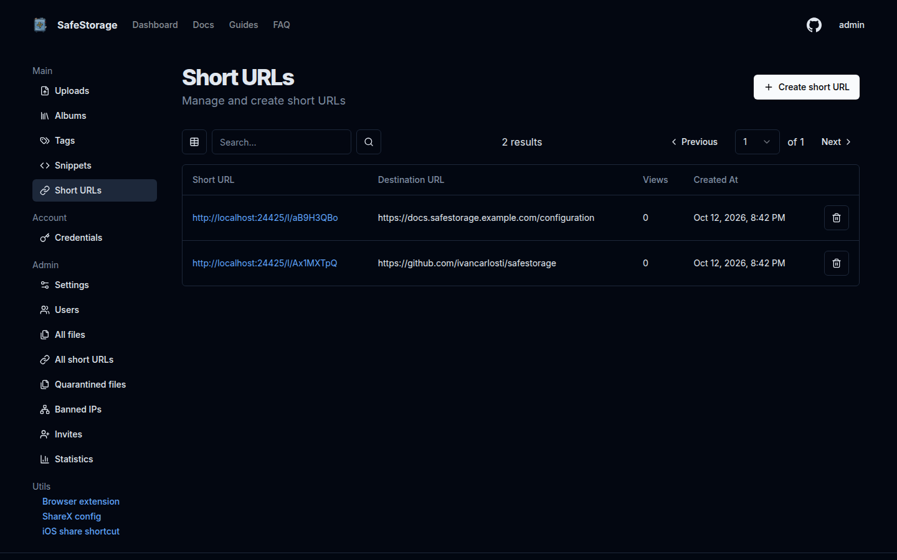                   | **Admin · Settings**<br>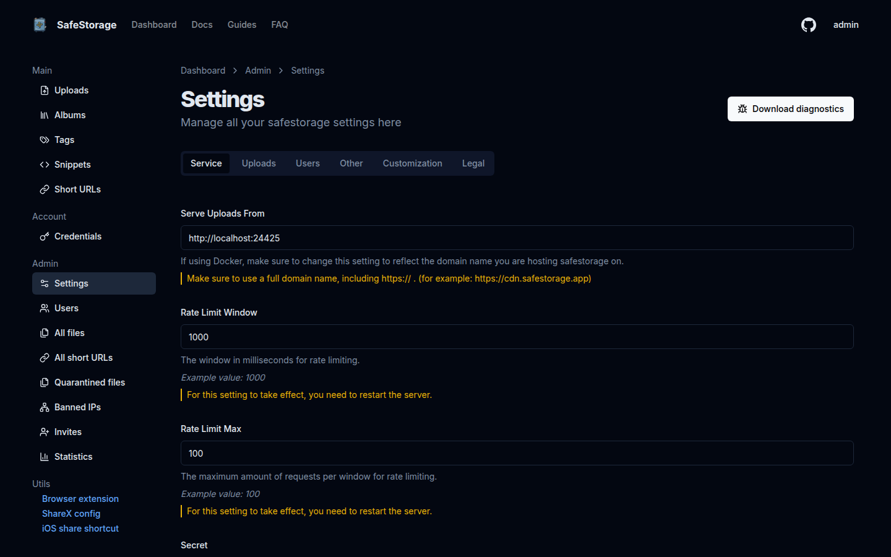     |
| **Admin · Statistics**<br>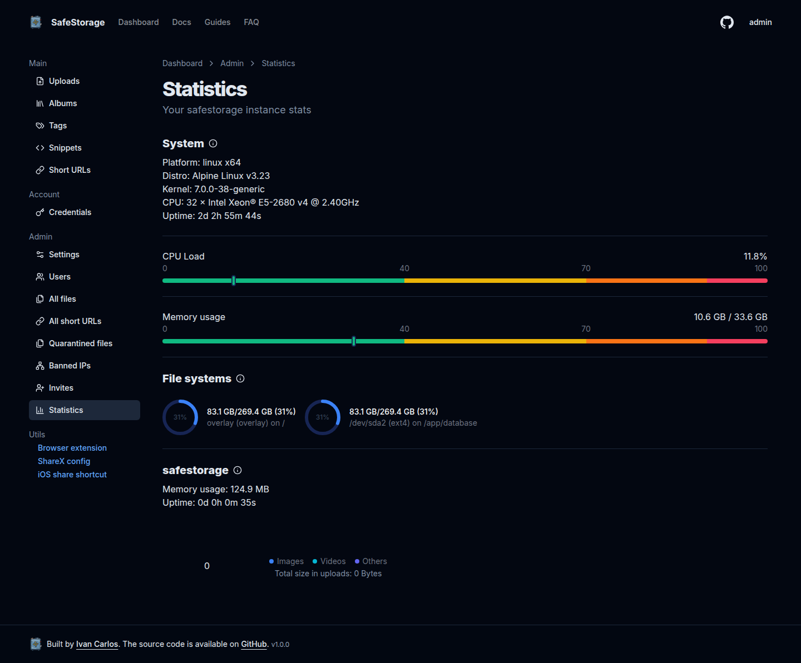 | **API reference**<br>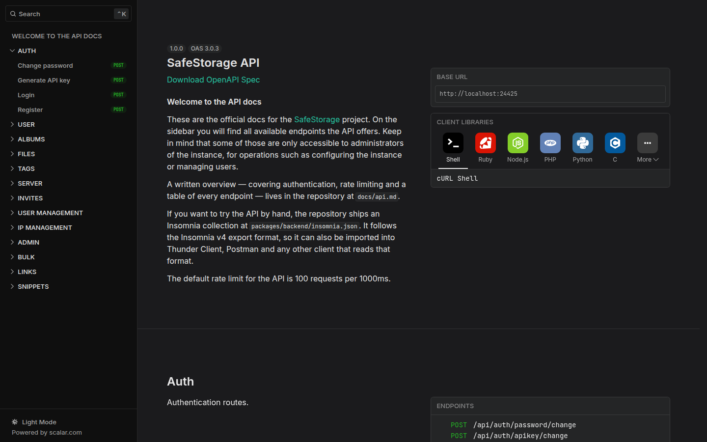 |

## Quick start (Docker)

The easiest way is the pull-only Compose stack in [`docker/`](docker):

```bash
git clone https://github.com/ivancarlosti/safestorage.git
cd safestorage/docker
cp .env.example .env     # set ADMIN_PASSWORD and (optionally) SAFESTORAGE_PORT
docker compose pull
docker compose up -d
```

Open `http://<your-host>:24424` and log in as `admin` with the password you configured. That's it — migrations run automatically on first boot.

Prefer building from source, or want TLS/backup guidance? See [docs/deployment.md](docs/deployment.md).

## Documentation

| Document                                           | Contents                                              |
| -------------------------------------------------- | ----------------------------------------------------- |
| [docs/deployment.md](docs/deployment.md)           | Docker deployment, TLS, backups, updates.             |
| [docs/configuration.md](docs/configuration.md)     | Every setting and environment variable.               |
| [docs/api.md](docs/api.md)                         | The REST API (a live reference is served at `/docs`). |
| [docs/storage.md](docs/storage.md)                 | Local disk vs. S3-compatible object storage.          |
| [docs/architecture.md](docs/architecture.md)       | How the project is put together.                      |
| [docs/development.md](docs/development.md)         | Local setup, scripts and the release flow.            |
| [docs/troubleshooting.md](docs/troubleshooting.md) | Common problems and fixes.                            |

## Tech stack

-   **Backend** — [Fastify](https://fastify.dev) · [Prisma](https://www.prisma.io) + SQLite · Zod · `@napi-rs/blake-hash` · ffmpeg
-   **Frontend** — [Next.js 14](https://nextjs.org) (App Router) · React 18 · Tailwind CSS · Radix UI · TanStack Query · Jotai
-   **Infra** — Node 20 · nginx · supervisord · Docker (multi-arch images on GHCR)

## Contributing

Contributions are welcome! Please read [docs/development.md](docs/development.md) first, keep commit messages in [Conventional Commits](https://www.conventionalcommits.org/) style, and make sure `yarn lint` and `yarn build` pass.

## License

Released under the [MIT License](LICENSE).

<!-- footer -->
